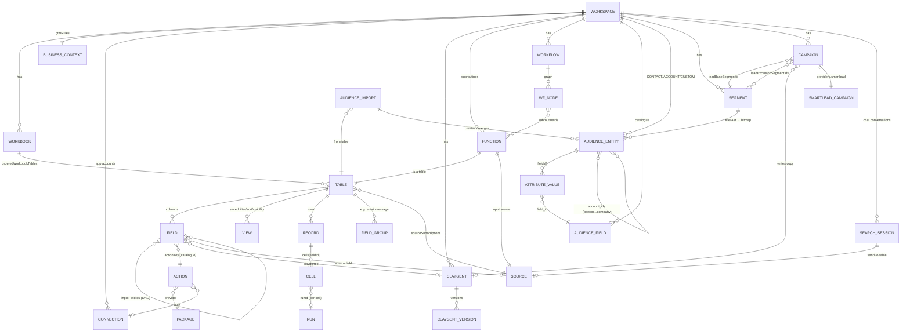

# Clay study — Phase 3: Data model

*Built 2026-11-18 from Clay's own API responses in our workspace, using read-only GETs plus the list call the UI
itself makes. Every object below was seen in a real payload **[V]** unless marked **[I]** (inferred). Full field
lists: [raw/phase3-notes.md](raw/phase3-notes.md). Behaviour evidence: [02-journeys.md](02-journeys.md).*

## 1. The big picture
Clay has **two data worlds** joined by imports and agents:

- **Workbook world (older, flexible).** Workbook → tables → fields (columns) → records (rows) → cells. Every
  enrichment, AI call and email draft lives in a *cell*, with its own run ledger.
- **Audience world (newer, canonical).** Entity-attribute-value records for People / Companies / custom objects,
  plus a field catalogue, segments, imports, signals and campaigns. Sequences now draw their leads from here.



**ID prefixes:**

| Prefix | Object |
|---|---|
| `wb_` | workbook |
| `t_` | table |
| `f_` | field |
| `gv_` | view |
| `r_` | record |
| `s_` | source |
| `run_` | run |
| `c_` / `cv_` | agent / agent version |
| `cc_` / `cm_` | chat conversation / chat message |
| `audseg_` | segment |
| `audimp_` | audience import |
| `cam_` | campaign |
| `wf_` / `wfn_` | workflow / workflow node |
| `msub_` | managed function |
| `sbmp_` | "already pulled" bitmap |
| *(numeric)* | Audience entity |

## 2. Workspace — the plan, the wallet and the switches  [V]
```jsonc
{
  "id": 1485570,
  "billingPlanType": "postPricingChange2026Trial",
  "centsPerCredit": 5,
  "credits":       { "basic": 934, "longExpiry": 0, "actionExecution": 4905, "cpjAllowance": 0, "agentAllowance": 0 },
  "creditBudgets": { "basic": …, "longExpiry": …, "actionExecution": …, "cpjAllowance": … },
  "featureFlags": {               // ~120 flags AND plan limits live here
    "tableColumnLimit": 100, "tableComputableColumnLimit": 40,   // ≤40 columns that run per table
    "interTableDagLimit": 20,                                    // max chained tables
    "planNumRowsLimit": 1000, "scheduledSourcesLimit": 100,
    "audienceWorkspaceRecordLimit": 1000000, "audienceSegmentLimit": 250,
    "audienceBitmapRefreshMinutes": 60, "restoreHistoryLimit": 30, …
  },
  "onboardingData": { "teams": […], "crmTools": […], "firstUseCase": "not-enough-customers", … },
  "abilities": { "canManageBilling": …, "canManageClaygents": …, "canExportToCRM": …, … }   // role permissions
}
```

**Reading:**
- The wallet has **five buckets**:
  - data credits (`basic`);
  - long-expiry credits;
  - **actions**, a separate count of executions;
  - people/company search allowance (`cpjAllowance`);
  - agent allowance.
- Budgets can be set per bucket, and per workbook or workflow (`budgetId` on each).
- Plan limits are data, not code.

## 3. Workbook, table, view  [V]
```jsonc
// Workbook
{ "id": "wb_…", "name": "…", "parentFolderId": null, "defaultAccess": "…", "creditLimit": null, "budgetId": null,
  "tags": [], "orderedWorkbookTables": [ { "id": "t_…", "name": "…", "tableType": "…", "firstViewId": null } ] }

// Table
{ "id": "t_…", "workbookId": "wb_…", "type": "company",          // company | spreadsheet | …
  "tableSettings": { "AUTO_RUN_ON": true, "AUTO_RUN_MODE": "keep_existing" },
  "isSandbox": false, "budgetId": null,
  "fieldGroupMap": { "gr_…": { "name": "New email", "type": "message_v2", … } },
  "fields": [ /* §4 */ ], "views": [ /* below */ ] }

// View = saved filter + sort + column layout
{ "id": "gv_…", "name": "Errored rows",
  "fields": { "f_…": { "order": "n", "width": 200, "isVisible": true } },
  "filter": { "combinationMode": "OR", "items": [ { "type": "HAS_ERROR", "fieldId": "f_…" },
            { "filterType": "Group", "combinationMode": "OR", "items": [ … ] } ] },
  "sort": null, "limit": null,
  "typeSettings": { "isPreconfigured": true, "preconfiguredType": "errored-rows" } }
```
Filters can test a cell's **run status** (HAS_ERROR, RUN_CONDITION_NOT_MET, IS_STALE, QUEUED…) as well as its
value.

## 4. Field — a column is a typed node in a dependency graph  [V]
```jsonc
{ "id": "f_…", "type": "action | formula | source | text | date | …",
  "inputFieldIds": ["f_a", "f_b"],          // DAG edges: what this column reads
  "conditionalRunFieldIds": [], "delayFieldIds": [],
  "isExtractedField": true, "extractedField": { "fieldIdExtractedFrom": "f_x", "extractedKeyPath": ".url" },
  "typeSettings": { … per type … },
  "supportedFilterOperators": [ { "operator": "IS_STALE", "needsValue": false }, … ] }
```

| `type` | `typeSettings` (essentials) | Behaviour |
|---|---|---|
| `action` | `actionKey`, `actionPackageId`, `inputsBinding[{name, formulaText:"{{f_x}}"}]`, optional `conditionalRunFormulaText`; carries a copy of the catalogue entry incl. **pricing** | Paid call to a provider or an AI. Result is JSON in the cell |
| `formula` / text | `formulaText: "{{f_x}}?.path"`, `mappedResultPath` | **JavaScript expression with lodash** (`_.trim(x) \|\| "fallback"`). Free and instant |
| `formula` / waterfall | `formulaWaterfall: [{formula}, …]`, `waterfallType` | First non-empty provider result wins |
| `source` | `sourceIds[]`, `canCreateRecords`, delete-cascade flags | The column a source writes new rows into |
| `text`/`number`/`date`/… | `dataTypeSettings{type}` | Plain user data |
| field group `message_v2` | `groupDetails{subjectField, bodyField}` with editable `dsl[]` segments | The editor keeps segments (Formula / CleanVariable / AI snippet); the fields store the **compiled formula** |

**How AI and email "reference other columns":** everything is `{{f_id}}` inside a formula string. A prompt is just
a string formula (`"I'm analyzing " + {{f_name}} + …`), and the email subject is a compiled formula. That single
mechanism gives the dependency graph and auto-run for free.

**How a waterfall is stored** (Phase 2):
- Provider *k* is an `action` with `conditionalRunFormulaText = AND(every earlier provider empty)`.
- The merge column is `formulaType: "waterfall"`.
- Validators are actions conditioned on "found an email that isn't yet verified".

## 5. Source — where rows come from  [V]
```jsonc
{ "id": "s_…", "type": "v3-action", "name": "Operations Managers, Asset Inspection",
  "typeSettings": {
    "actionKey": "run-search-dsl-export-to-s3",
    "inputs": { "dslQuery": "select from people where …", "entityType": "…",
                "previous_entities_bitmap": "sbmp_…" },        // don't re-pull what we already have
    "recordsPath": "people", "idPath": "clay_metadata.clay_profile_id",   // dedupe key
    "sourceRecordLimit": 50000,
    "disableTriggerOnCreate": true, "disableTriggerOnUpdate": true },
  "state": { "action": { "status": "SUCCESS" }, "lambdaInfo": { "isFirstRun": false, "numConsecutiveErrors": 0 },
             "numSourceRecords": 76 },
  "sourceSubscriptions": [ { "tableId": "t_…", "fieldId": "f_people_search" } ] }   // 1 source → N tables
```
Signals, CSV, webhooks and searches are all sources.
- A **signal** is a source on a schedule (monthly / weekly / daily…). **[V]** in the UI; the field name for the
  schedule wasn't captured.
- Company → people chaining is an *action column* (`trigger-find-people-source`) that re-runs a people source for
  each new company row.

## 6. Record and cell — the heart of it  [V]
```jsonc
// Record
{ "id": "r_…", "tableId": "t_…", "dedupeValue": null,
  "recordMetadata": { "runHistory": { "f_enrich_person": [ { "time": 1795003253859, "runId": "run_…" } ] } },
  "cells": { "f_…": Cell } }

// Cell (list view: preview only)
{ "value": "Perplexity",
  "metadata": { "status": "SUCCESS", "isPreview": true, "imagePreview": "…",
                "confidence": "low",                         // AI cells
                "isStreamingProgress": true, "streamingProgressKey": "run_…" } }

// Cell (full record) — the per-cell run ledger
{ "value": "…", "metadata": { … },
  "extendedContent": { "runId": "run_…", "queuedAt": 1795…, "finishedAt": 1795…, "inputsHash": "…" },
  "externalContent": {
    "runId": "run_…", "status": "SUCCESS", "logInfo": { "url": "<datadog>", "requestId": "…" },
    "inputsHash": "…",                       // basis for stale detection [I]
    "fullValue": { … complete provider / AI JSON … },
    "hiddenValue": { "messages": [ { "role": "…", "content": "…" } ], "langSmithTraceURL": "…" },   // AI transcript
    "isRefunded": false,
    "upfrontCreditUsage":   { "totalCost": 0.1, "basicCreditsUsed": 0.1, "actionExecutionsUsed": 1, … 11 buckets },
    "additionalCreditUsage": { "totalCost": -0.1, "basicCreditsUsed": -0.1 }   // true-up after the real cost
  } }

// Cell that did not run
{ "metadata": { "status": "ERROR_RUN_CONDITION_NOT_MET" },
  "extendedContent": { "cellDidNotRunInfo": {
      "inputToErrors": { "email": { "evaluationError": "BLANK", "inputDisplayName": "Email" } },
      "conditionalRunInfo": { "inputErrors": [] }, "delayInfo": { "inputErrors": [] } } } }
```

**Cell status** values:
- seen live: `SUCCESS`, `SUCCESS_NO_DATA` (refundable), `ERROR_RUN_CONDITION_NOT_MET`, `AWAITING_CALLBACK`;
- also present as filter states: has-not-run, `QUEUED`, `RUNNING`, `RETRY`, `ERROR`, `IS_STALE`, cancelled.

**Reading:**
- The **cell is the unit of work, cost and audit**. Each cell records what ran, when, on which inputs (hash), what
  it cost (charged up front, then trued up), the full result, and for AI the full transcript.
- There's no separate job table. A "run" is just a `runId` stamped on cells. **[I]** No run list endpoint was
  found; the only public-API run list is `routine-runs`.

## 7. How runs are triggered and re-run  [V unless marked]
1. **Auto-run** (`AUTO_RUN_ON`): a cell runs when one of its `inputFieldIds` changes or a new record arrives.
   `AUTO_RUN_MODE: keep_existing` means only empty, errored or new cells run.
2. **Run condition:** a formula that must be truthy, otherwise the cell is `RUN_CONDITION_NOT_MET`. Waterfalls are
   built from this.
3. **Delay:** 0–600 s after conditions are met.
4. **Manual:**
   - `PATCH ~/tables/{t}/run {fieldIds, runRecords{recordIds}, forceRun}`;
   - "Save and run 10 / N in view / don't run" when a column is created;
   - "Run column ▸ empty or out-of-date / force all".
5. **Stale:** `inputsHash` is stored per cell, and `IS_STALE` exists as a filter.
   - Changing the agent or the business context did **not** mark cells stale, because neither is a column input.
     **[V]**
   - Stale presumably covers changes to input columns only. **[I]**
6. **Limits:** ≤40 columns that run per table; ≤20 chained tables (`interTableDagLimit`).

## 8. Agents, context, search sessions  [V]
- **Claygent:** `{currentVersion{versionNumber, userPrompt, variables[], modelSettings{model, internetSearchEnabled,
  shouldIncludeAllBusinessContext, …}, outputFormat{jsonSchema}, skills[], isPublished}}`.
  - Save makes a draft version; Deploy publishes it.
  - A table column binds `claygentId` with no version, so it uses the latest version live.
- **Business context:** `gtmRules{companyDescription, ICP, personas}` + `domain`. It's referenced with `@` or included
  wholesale.
- **Search session:** a chat conversation (`cc_`, messages with role / parts / feedback) plus a `sourceState{sourceType,
  sourceConfig{mode:"dsl", filters{62 keys}, originalQuery}}`.
  - The preview runs through `POST search-dsl/query`; saving runs `search-dsl/send-to-table`, which creates a
    Source.

## 9. Audience world  [V]
```jsonc
// Field catalogue (Data hub)
{ "id": "…", "entityType": "CONTACT", "fieldType": "SCALAR", "dataType": "text|email|url|…",
  "displayName": "First name", "isDefaultField": true, "isSystemField": false, "order": "…", "hidden": false }

// Entity (EAV)
{ "entity": { "id": 3451770152, "version": 2, "cpj_id": …,          // Clay's global person id
              "fields": [ { "field_id": "…", "value_type": "…", "value": "…" } ],
              "account_ids": [], "signals_aggregated": [] },
  "aliases": [ … ],                 // identity keys: email, LinkedIn URL, phone, external id, twitter
  "accounts": [], "signals": {}, "externalSourceSyncStatuses": {} }

// Import (table → audience)
{ "id": "audimp_…", "sourceId": "t_…", "entityType": "CONTACT", "status": "…", "importedCount": 76,
  "fieldMapping": { "version": 1, "fieldMappings": [ … ] },
  "importMetadata": { "tableId": "t_…", "viewId": "gv_…", "totalCount": 76, "startTime": "…", "endTime": "…" } }

// Segment
{ "id": "audseg_…", "entityType": "CONTACT",
  "filterAst": { "type": "GroupOp", "items": [ { "type": "BinOp", "key": "sources", "operator": "…",
                 "dataPath": ["contact_entity_field_values","field","sources"], "value": "audimp_…" } ] },
  "estimatedSize": 0, "bitmapProcessedAt": "…" }          // membership = bitmap refreshed hourly
```
- **Entity types:** `CONTACT`, `ACCOUNT`, and `CUSTOM` with `objectType` (e.g. `OPPORTUNITY`), so custom objects
  exist.
- **Identity** is merged on first import by matching one alias field. Merges can't be undone.
- **Our import:** 76 people, all with **empty `account_ids`** (not linked to companies), and first/last name only
  8% filled because of Auto-map.

## 10. Campaign, function, workflow  [V]
```jsonc
// Campaign (sequence)
{ "id": "cam_…", "status": "draft", "enrollmentMode": "segment",
  "leadBaseSegmentId": "audseg_…", "leadExclusionSegmentIds": [],
  "claygentId": "c_…", "claygentContext": { "attachedContextItems": [] },          // agent writes the copy
  "sequence": [ /* steps */ ],
  "settings": { "trackingSettings": { "trackEmailOpen": false, "trackLinkClick": false },
                "scheduleSettings": { "scheduleType": "prioritize_deliverability", "timezone": "…",
                                      "daysOfWeek": ["mon",…], "startHour": "09:00", "endHour": "17:00",
                                      "minTimeBetweenSteps": 20, … } },
  "providers": { "smartlead": { "clientId": …, "campaignId": … } } }   // sending is delegated to Smartlead

// Function (subroutine) = a table with an input source, priced per run
{ "sourceId": "s_…", "table": { "type": "spreadsheet", "name": "Person LinkedIn URL", … },
  "cost": 2.2, "actionExecutionCost": 0.9, "containsVariablePricing": false, "referenceCount": 0,
  "managedSubroutineSubscription": { "managedSubroutineId": "msub_…" } }   // Clay-managed = subscription

// Workflow
{ "workflow": { "id": "wf_…", "liveWorkflowSnapshotId": null, "waterfallConfig": null, "stats": {…},
                "triggerSummaries": [] },
  "graph": { "nodes": [ { "id": "wfn_…", "nodeType": "…", "nodeConfig": {…}, "subroutineIds": [],
                          "position": { "x": 0, "y": 0 } } ],
             "edges": [], "nodeGroups": …, "validation": …, "workflowInputSchemasByTriggerNodeId": … } }
```
Creating a sequence also created a hidden "Campaign events" workbook, so send / reply events land in a table.
**[V]** for the workbook; its contents weren't seen.

## 11. Credits — where the ledger lives  [V]
- **Per cell:** `upfrontCreditUsage` (11 buckets: basic, actions, search allowance, budget, signal, workbook,
  workflow, long-expiry…) plus `additionalCreditUsage` (true-up) plus `isRefunded`.
- **Per catalogue action:** `pricing{credits{basic}, refundRules{SUCCESS_NO_DATA:true}}`, plus 1 action per
  execution.
- **Reporting:**
  - `credit-reporting/{ws}/balanceTimeSeries`, `spendTimeSeries`, `spikeEvents`;
  - the UI rolls up Workspace → Workbook → Table (our run: 66 credits / 95 actions → company table 55/56, people
    table 10/38), and table History goes down to column and run.
  - **[I]** Reports are aggregates of the cell ledger.

## 12. Paging and live updates
- **Tables:** `records/ids` (all ids), then `bulk-fetch-records` for the visible window (a virtualised grid).
  `records?limit&offset` also exists. **[V]**
- **Audiences:** `limit/offset` + `pagination`. **Workflows:** cursor. **[V]**
- **Live updates:** while cells run, the UI repeatedly re-fetches the changed records. **[V]** (repeated
  bulk-fetch calls)
  - AI progress uses `streamingProgressKey`. **[V]** for the field; the transport wasn't seen.
  - Notifications go through Knock. **[V]**

## 13. What this means for Signal Intel (feeds Phase 4)

| Clay | Our equivalent today | Gap |
|---|---|---|
| Field (column) with `inputFieldIds`, run condition, auto-run | `predicate` (no inputs, no conditions) | Need predicate **inputs, dependencies and run conditions** |
| Cell with status + run ledger + full value + transcript | `claim` (value + evidence + confidence) | Ours has **evidence**, Clay's doesn't. We lack **status, inputsHash/stale, cost per claim, transcript** |
| Waterfall = ordered providers + "run if earlier empty" + merge | Hunter only | A waterfall is just predicates with conditions; it falls out of the dependency model |
| Source + subscriptions, signals = scheduled sources | radars | Our radars are sources; we lack **dedupe bitmap / idPath** and fan-out to tables |
| Audience entity (EAV) + alias merge + field catalogue with fill rate | `entity` + predicates | Close match. Add **aliases / identity merge** and a **coverage view** |
| Segment `filterAst` → bitmap | (none; labels planned) | Saved views/segments over claims |
| Business context `gtmRules` | Brief | Ours is richer. Clay shows that **every AI call must read it**, and that results must go stale when it changes (Clay doesn't) |
| Campaign → segment + agent + Smartlead | campaign push (not writing yet) | Native send from the user's Gmail/Outlook (agreed direction) |
| Per-cell credit ledger, 5 wallet buckets | none | Cost per claim / per run is needed for "cost before run" |

**Key design takeaways:**
- One `{{ref}}` formula mechanism powers dependencies, AI prompts and email composition.
- The cell (our claim) should be the unit of work, cost and audit.
- Version AI configs, and **do** mark old results stale when the Brief or the agent changes. Clay doesn't, and
  that's a weakness we can avoid.
