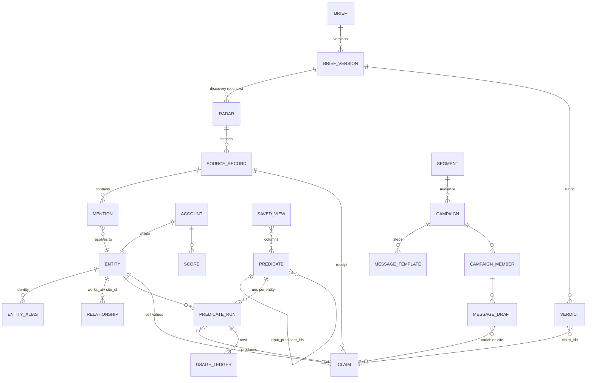

# Clay study — Phase 4: Mapping Clay to Signal Intel

*2026-11-18. Inputs: [01](01-feature-inventory.md), [02](02-journeys.md), [03](03-data-model.md), our migrations
(`supabase/migrations/2026110*`), the PRD and the [engine test study](../../investigations/2026-11-17-engine-test-study.md).
Schema changes here are **proposals for review**. Nothing is migrated until the Phase 5 spec is approved.*

## 1. The one-paragraph answer
Clay is a spreadsheet of paid lookups that is slowly becoming a record system (Audiences). Signal Intel started as
a record system with evidence (`entity` / `predicate` / `claim` with `source_record` receipts) and lacks the
spreadsheet's **operating surface**:
- columns you can add and run;
- per-cell status and cost;
- waterfalls;
- views;
- email built from columns.

So we **don't copy Clay's tables**. We add a thin **run layer** and a **view layer** on top of the graph we have.
Then *every* way of filling a column (extract from evidence, call a provider, ask an AI agent, compute a formula)
writes the same thing: a claim with a receipt.

## 2. Object-by-object mapping

| Clay object | Our nearest table(s) | Decision | Why / what changes |
|---|---|---|---|
| Workspace (+ wallet, limits as flags) | `workspace`, `workspace_settings`, `budget`, `platform_setting` | **Adapt** | Keep one USD budget (`budget`, `usage_ledger`), not five credit buckets. Adopt "limits are data" (already in `workspace_settings`). |
| Business context (`gtmRules`) | `brief` + `brief_version.config` | **Ours is richer. Adopt "generate from domain"** | The Brief also drives discovery, rubric and weights. Adopt the one-click "generate from domain" into Brief intake. |
| Workbook | — | **Reject** | A workbook is a folder of table *copies*. That breaks PRD principle 1 ("lenses, not folders"). Our grouping is the Brief. |
| Table | `entity` filtered by type + Brief, shown through a **saved view** | **Reject as storage; adopt as surface** | Clay duplicates rows per table (two worlds, unlinked people). We render one graph through views. |
| Field (column) | `predicate` | **Adapt (biggest change)** | Add how a predicate is filled, its inputs, run condition, auto-run and version. See §4.1. |
| Formula field | — | **Adopt, restricted** | Derived predicates from a small, safe expression language (not arbitrary JS). |
| Waterfall | `m07_enrichment` (Hunter only) | **Adopt** | Becomes a predicate whose fill method is `provider` with an ordered provider list, a stop-on-first-hit rule, and optional validation. |
| Action catalogue (1,576 actions) | `integration`, enrichment providers | **Adapt, small** | A curated provider list per value type (email, phone, firmographics), not a marketplace. |
| Claygent / Use AI column | `research_job`, `research_doc`, `extractor_version` | **Adapt** | A predicate whose fill method is `research` runs an agent prompt with the Brief as context. `extractor_version` already versions prompt + model + hash. |
| Source (search / CSV / webhook / signal) | `radar`, `radar_query`, `source_record`, `targeted_search` | **Adapt** | Radars are our sources. Add a schedule, a "find people at accounts" radar, and dedupe memory. |
| Search session (AI chat → query) | Brief intake / `brief_preview` | **Adopt pattern** | The Brief preview should show the *editable structure* the AI built and **state its approximations**. |
| Record + cell | `entity` + `claim` (+ new `predicate_run`) | **Adapt** | Our claim = Clay's cell value **plus evidence**. Clay's run metadata goes in a new run table (§4.2). |
| Cell status / run ledger / inputsHash | — | **Adopt** | Needed for statuses, staleness, cost per cell and retries. |
| View (filter + sort + columns) | `segment.filter` (no layout) | **Adopt** | New `saved_view`. Its filter uses one shared filter syntax with `segment`. |
| Sandbox Mode | Brief `Pilot` state + `pilot_sample` | **Already ours; surface it** | Pilot is our sandbox. Make it visible as "test on N accounts → review → publish". |
| 10-row test run | — | **Adopt, explained** | Default first run on a small sample, with a clear banner and "run the rest (est. $X)". |
| Audience entity (EAV) + aliases | `entity`, `entity_alias`, `claim` | **Already ours** | Same shape. Ours links people to companies (`relationship` works_at), which Clay's import didn't. |
| Identity merge rule | `m04_identity`, `entity_alias` | **Ours is better** | Clay can't undo a merge. Ours can (F2). Add an `email` alias type for people. |
| Data hub (field coverage) | `data_completeness` (pipeline-level) | **Adopt** | A per-predicate coverage view: fill rate, accounts covered, which fill method filled it. |
| Segment (filterAst → bitmap) | `segment` | **Keep, unify the filter syntax** | Same filter syntax as `saved_view`. Membership is live, not refreshed hourly. |
| Message column / AI snippet / clean variable | `campaign_member.variables` | **Adopt** | New message template with typed segments (§4.4). Every sent message records its variables (PRD Part 8). |
| Campaign → segment + agent + Smartlead | `campaign`, `campaign_member`, `integration` | **Adapt** | Send from the user's own Gmail/Outlook (agreed). Keep exclusion segments and schedule settings. |
| Functions (table-as-function) | — | **Defer to V2** | A library of predicate templates covers it. |
| Workflows (node graph) | Brief + radars + predicates + stage rules | **Reject for V1** | Our pipeline is opinionated; a free-form graph adds a second way to do everything. |
| Ads, Agent users / MCP | M13 API / MCP | **Out of scope** for this redesign | — |
| Credit reporting rollups | `usage_ledger` | **Adopt** | Roll cost up Workspace → Brief → predicate → account, and show it *before* runs. |

## 3. Our differentiators (keep and make visible)
1. **Evidence-backed cells.** Every value has a source, a quote and a confidence (`claim.quote`,
   `source_record_id`, `confidence`). Clay keeps a transcript but no evidence. **UI:** every cell opens to its
   receipt.
2. **Brief-driven discovery.** Clay starts from a list you pull. We start from a hypothesis and *find* the rows
   (radars). In the FlytBase test, Clay's best search gave 45 companies from firmographic and semantic filters.
   Ours finds companies through deployments, tenders and hiring.
3. **Verdicts with a rubric.** Clay's agent gave "Moderate Fit" to every company, with or without an ICP. Ours
   should be `Confirmed / Likely / Unverified / Contradicted`, citing `claim_ids` and computed from the versioned
   rubric. (This needs gap #8 fixed; today it's a free AI judgement.)
4. **Versioned meaning and honest staleness.** PRD principle 5 already asks for it: Clay leaves old answers looking
   current after the context or agent changes. We mark them **stale** and offer "re-run (est. $X)".
5. **One graph, many lenses.** People stay linked to the account and site. No "Fugro India → global Fugro staff"
   mismatch, because a person matches through the *site / company entity*, not a bare domain.

## 4. Schema deltas (proposals)

### 4.1 `predicate` becomes a column definition
```sql
alter table public.predicate
  add column fill_method   text not null default 'extract'
      check (fill_method in ('extract','provider','research','formula','manual')),
  add column fill_config   jsonb not null default '{}',   -- see below
  add column input_predicate_ids uuid[] not null default '{}',  -- dependency edges (DAG)
  add column run_condition jsonb,                          -- filter-AST over inputs; null = always
  add column auto_run      boolean not null default true,
  add column version       int not null default 1,          -- bump on any fill_config change
  add column config_hash   text,                            -- hash(fill_method, fill_config, inputs)
  add column cost_estimate_usd numeric(10,4);               -- per entity, shown before runs
```

| `fill_method` | `fill_config` example | Writes |
|---|---|---|
| `extract` (today) | `{ "hint": "...", "backfill": true }` | Claims from existing `source_record`s. Free; backfill on create (fixes #7) |
| `provider` (waterfall) | `{ "providers": ["leadmagic","findymail","prospeo"], "stop": "first_hit", "validate": "findymail" }` | Claim with the provider response as the receipt |
| `research` (AI agent) | `{ "prompt": "...{{predicate:headcount}}...", "web": true, "brief_context": "all", "output_schema": {...} }` | Claim + `research_doc` link; transcript stored as the receipt |
| `formula` | `{ "expr": "coalesce(p.work_email, p.personal_email)" }` | Derived claim pointing at the input claims; no cost |
| `manual` | `{}` | Claim with `source_type = 'user'` |

The AI draft must create predicates (fixes **#1**). Scoring must read predicates by *role* from the Brief weights
instead of hard-coded keys (fixes **#11**).

### 4.2 New `predicate_run`: the run layer (Clay's cell metadata)
```sql
create table public.predicate_run (
  id uuid primary key default gen_random_uuid(),
  org_id uuid not null, workspace_id uuid not null,
  entity_id uuid not null references public.entity (id),
  predicate_id uuid not null references public.predicate (id),
  predicate_version int not null,
  brief_version_id uuid references public.brief_version (id),
  status text not null check (status in
    ('queued','running','awaiting_callback','succeeded','no_data','condition_not_met','error','cancelled')),
  inputs_hash text not null,              -- hash of input claim ids + predicate config + brief version
  not_run_reason jsonb,                   -- {input:"email", error:"blank"} like Clay's cellDidNotRunInfo
  provider text, attempt int not null default 1,
  cost_usd numeric(14,6) not null default 0, refunded boolean not null default false,
  claim_id uuid references public.claim (id),   -- the claim it produced, if any
  transcript_ref text,                    -- AI messages / trace (object storage)
  queued_at timestamptz not null default now(), started_at timestamptz, finished_at timestamptz,
  error text
);
create index on public.predicate_run (entity_id, predicate_id, queued_at desc);
```
- **Cell state** = latest run + current claim. **Stale** = latest run's `inputs_hash` ≠ hash recomputed now. So a
  change to the predicate, the Brief or an input claim makes it stale (better than Clay).
- `usage_ledger` gains `predicate_run_id`. Cost rolls up per cell, predicate, account and Brief.
- `enrichment_job` / `research_job` become batch wrappers that enqueue `predicate_run`s (Procrastinate).

### 4.3 New `saved_view`, with a shared filter syntax
```sql
create table public.saved_view (
  id uuid primary key default gen_random_uuid(),
  org_id uuid not null, workspace_id uuid not null,
  brief_id uuid references public.brief (id),          -- null = all Briefs
  entity_type public.entity_type not null default 'company',
  name text not null,
  columns jsonb not null default '[]',   -- [{kind:"predicate"|"system", ref, width, pinned}]
  filter jsonb not null default '{}',    -- shared AST (same as segment.filter)
  sort jsonb not null default '[]',
  layout text not null default 'table' check (layout in ('table','board','map')),
  visibility text not null default 'workspace' check (visibility in ('personal','workspace')),
  preset text,                           -- 'errored', 'stale', 'needs_review', 'ready_to_contact'
  created_by uuid references public.member (id), created_at timestamptz not null default now()
);
```
- The filter AST can test **values** (claims), **verdict / score / stage**, and **run status** (error, stale,
  condition-not-met), as Clay does.
- `segment` keeps membership semantics for campaigns and reuses the same AST.

### 4.4 Messages built from columns
```sql
create table public.message_template (
  id uuid primary key default gen_random_uuid(),
  org_id uuid not null, workspace_id uuid not null,
  campaign_id uuid references public.campaign (id) on delete cascade,
  step int not null default 1, variant text not null default 'A',
  subject jsonb not null,   -- [{t:"text",v:"Drone inspections at "},{t:"field",ref:"company.name",fallback:"your team",case:"title"}]
  body    jsonb not null,   -- + {t:"ai_snippet",prompt:"...",max_words:40} + {t:"if",cond:AST,then:[...],else:[...]}
  delay_days int not null default 0,
  version int not null default 1, created_at timestamptz not null default now()
);
create table public.message_draft (
  id uuid primary key default gen_random_uuid(),
  org_id uuid not null, workspace_id uuid not null,
  campaign_member_id uuid not null references public.campaign_member (id) on delete cascade,
  template_id uuid not null references public.message_template (id), template_version int not null,
  subject text not null, body text not null,
  variables jsonb not null,      -- every field/claim used, with claim_ids (PRD Part 8)
  ai_runs uuid[] not null default '{}',
  approval text not null default 'pending' check (approval in ('pending','approved','rejected','sent')),
  created_at timestamptz not null default now()
);
```
- **Field refs** can reach the linked account (company, site) and **cite claims**. An AI snippet can only use
  claims that have receipts, which is a better pitch than Clay's free AI copy.
- V1 approval is human (PRD). The template is versioned, and the draft records its variables.

### 4.5 Smaller deltas
- `alias_type` gains `email`, `phone` (person identity).
- `radar`:
  - add `schedule` (cron / frequency) and `next_run_at`;
  - extend `connector_type` with `company_search`, `people_at_accounts`, `webhook`;
  - add a seen-entity set for dedupe (like Clay's bitmap).
- People-at-accounts matching keys on `entity` (company **and site / country**), not domain only.
- `claim.value`: store real typed JSON, and enforce `predicate.value_type` (fixes **#5**). Claims are written in
  one idempotent batch, keyed by `(entity, predicate, source_record, value)` (fixes **#6**).
- Verdict recompute is triggered by `claim.created` / `entity.merged` events, with a rubric version (fixes
  **#3**, **#8**). Repeat sightings attach to the account (fixes **#2**).
- Coverage view: per predicate (and Brief), fill rate, accounts covered and fill method. A view over
  `claim` + `predicate_run`.

## 5. The model after the deltas

In Clay terms:
- **row** = entity (account / person / site);
- **column** = predicate;
- **cell** = latest claim + latest run;
- **table** = saved view;
- **workbook** = Brief;
- **source** = radar;
- **waterfall / AI column** = predicate fill method;
- **message column** = message template.

## 6. What we adopt from Clay's UX (carried into Phase 5)
- **Outcome-first column catalogue:** "Work email", "Headcount", "Uses drones?" each pick a sensible fill method
  automatically. Cost per account is shown on every item.
- **Cost before every run:**
  - "Run 10 (est. $0.40) / run all 54 (est. $2.10) / save without running";
  - a running total in setup wizards.
- **Small-sample first run, with a visible banner and a "run the rest" button.**
- **AI-first inputs that return an editable structure and name their approximations:** Brief, column, view filter,
  message.
- **Live 5-row preview** while configuring a column or a message.
- **Waterfall UI:** collapsed group, provider icon, ✓/✗ per cell, "skipped, earlier provider found it".
- **Cell details panel:** value, quote, source link, confidence, run history, cost. Ours adds evidence.
- **Preset views:** Errored, Stale, Needs review, Ready to contact.

## 7. What we reject, and why
| Clay behaviour | Why not |
|---|---|
| Tables as data copies; workbooks | Two sources of truth. People left unlinked to companies (Phase 2) |
| Arbitrary JavaScript formulas | Security and support cost. A small expression language covers coalesce / concat / compare |
| Results not marked stale after the agent or context changes | Violates our versioned-meaning principle |
| Coarse 3-tier AI score as the decision | Our verdict + rubric + score bands with evidence |
| Domain-only people matching | Wrong country staff. Match through the company / site entity |
| Silent auto-map of import fields | Show the mapping with sample values and flag the provider-vs-merged confusion |
| Five credit buckets | One USD budget; show cost in money |
| Free-form workflow graph (V1) | Doubles the ways to do things; our pipeline is the workflow |
| Merge that can't be undone | We keep reversible merges (F2) |

## 8. Part A gaps: where each lands

| Gap (engine study) | Resolved by |
|---|---|
| #1 AI draft creates no predicates | §4.1: the Brief draft must emit predicates with fill methods |
| #2 repeat sightings → Review | §4.5: attach to the existing account |
| #3 verdicts don't recompute | §4.5 events + `predicate_run` staleness |
| #4 relevance ignores Brief | Radar relevance uses `brief_version.config` (unchanged plan) |
| #5 JSON-in-string values | §4.5 typed values |
| #6 duplicate claims | §4.5 idempotent batch |
| #7 no backfill | §4.1 `extract` with `backfill: true` runs on create |
| #8 verdict not rubric | §3.3 + §4.5 rubric version |
| #9 / #10 radars | §4.5 radar types / schedule (providers: separate decision) |
| #11 hard-coded scoring | §4.1 predicates by role in Brief weights |
| Accounts: no predicate columns / views / export / board | §4.3 `saved_view` (table / board / map) |
| Enrichment: Hunter only, never on demand | §4.1 `provider` waterfall + run controls |
| Research: no manual trigger | §4.1 `research` predicate + run controls |
| Campaign push never writes | §4.4 templates / drafts + native send |
| Reports: tiles only | Coverage view + cost rollups |
| Map / sites view | `saved_view.layout = 'map'` |

## 9. Decisions for you (before Phase 5)
1. **Provider set for waterfalls.** My recommendation: start with 2–3 for email (e.g. LeadMagic, Findymail,
   Prospeo) and one for firmographics. Don't build a marketplace.
2. **People search source.** Clay's strength is a 300M-person index. Do we license one (e.g. People Data Labs /
   Apollo API) for "find people at accounts", or rely on providers per account? My recommendation: a per-account
   people lookup via one provider in V1.
3. **Formula language.** My recommendation: a small safe subset (coalesce, concat, compare, contains, number ops),
   not JavaScript.

Everything else above follows from principles already in the PRD.
